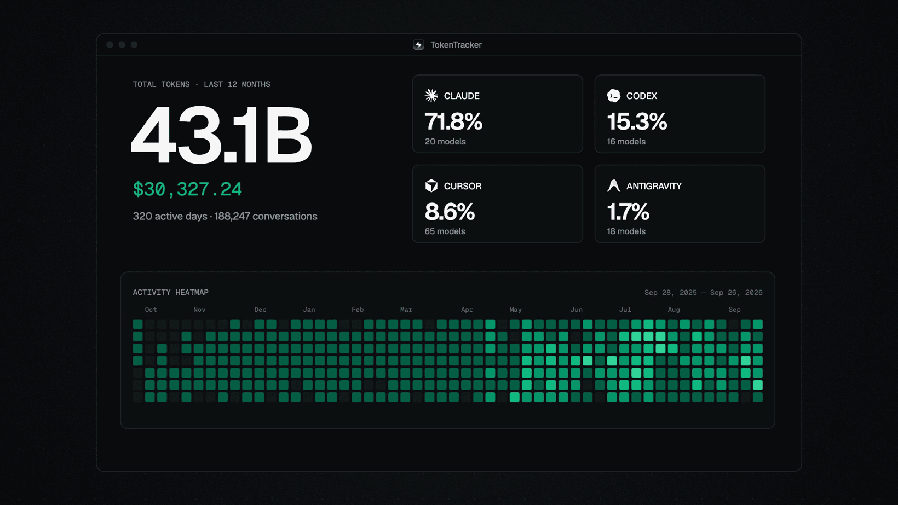
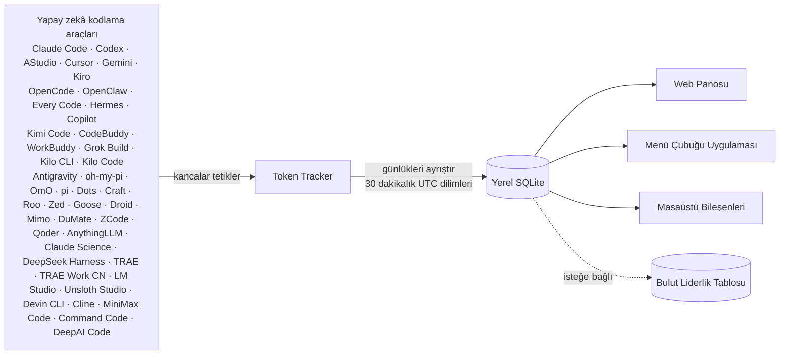

<div align="center">

# Token Tracker

[English](./README.md) · [简体中文](./README.zh-CN.md) · [日本語](./README.ja.md) · [한국어](./README.ko.md) · [Deutsch](./README.de.md) · **Türkçe**

### Her yapay zekâ token'ını takip edin — ardından kullanımınıza hayat verin

**48 yapay zekâ kodlama aracı** için doğru, yerel öncelikli (local-first) bir token kullanımı ve maliyet panosu — ayrıca bir masaüstü evcil hayvanı, **4 yerel bileşen (widget)** ve **15 başarı yolu**. Bulut hesabı yok, API anahtarı yok, kurulum gerektirmez.

[](https://www.npmjs.com/package/tokentracker-cli)
[](https://www.npmjs.com/package/tokentracker-cli)
[](https://github.com/xiufengsun/homebrew-tokentracker)
[](https://opensource.org/licenses/MIT)
[](https://www.npmjs.com/package/tokentracker-cli)
[](https://github.com/xiufengsun/TokenTracker/releases/latest)
[](https://github.com/xiufengsun/TokenTracker/releases/latest)
[](https://github.com/xiufengsun/TokenTracker/stargazers)
[](https://github.com/ruanyf/weekly/blob/master/docs/issue-393.md)
[](https://github.com/xiufengsun/TokenTracker)

<br/>

<strong>📊 Token panosunu iş başında görün</strong>

<br/><br/>

<video src="https://github.com/user-attachments/assets/3275979d-bbed-4639-83e2-8b7d83bed6af" controls muted playsinline poster="https://raw.githubusercontent.com/xiufengsun/tokentracker/main/docs/screenshots/dashboard-light.png" width="820"></video>

<br/><br/>

<table>
<tr>
<td width="58%"></td>
<td width="42%"></td>
</tr>
<tr>
<td><strong>🐾 Yaşayan bir masaüstü arkadaşı</strong><br/>Kod yazar, serileri kutlar, imlecinizi takip eder ve siz dinlendiğinizde dinlenir.</td>
<td><strong>🧩 Dört yerel bileşen</strong><br/>Kullanım, etkinlik ısı haritası, en çok kullanılan modeller ve hız limitleri tek bakışta.</td>
</tr>
</table>

<p>
  
  
  
  
  
</p>

<strong>🏆 Gerçek kodlama şeklinizle başarıların kilidini açın.</strong>

<br/><br/>

<strong>🎬 TokenTracker ile Tanışın</strong>

<br/><br/>

<video src="https://github.com/user-attachments/assets/efb89086-b7d7-4cb6-ae3c-3a6cb50188d2" controls muted playsinline poster="https://raw.githubusercontent.com/xiufengsun/tokentracker/main/docs/screenshots/intro-film-poster.png" width="820">
  
</video>

<br/><br/>

⭐ **TokenTracker size zaman kazandırıyorsa lütfen [GitHub'da yıldız verin](https://github.com/xiufengsun/TokenTracker) — diğer geliştiricilerin de bulmasına yardımcı olur.**

<br/>

[](https://ko-fi.com/M4M11XSNWD)

</div>

---

Bu proje BrowserStack ile test edilmektedir.

---

## ⚡ Hızlı Başlangıç

> **Gereksinimler**: Node.js **20+** (CLI macOS / Linux / Windows üzerinde çalışır; yerel masaüstü uygulaması macOS (menü çubuğu), Windows (sistem tepsisi) ve Linux (AppImage, tepsi) için sunulur. Cursor token okuması mevcut olduğunda sistemdeki `sqlite3` CLI aracını kullanır ve desteklenen Node sürümlerinde `node:sqlite` modülüne geri döner).

```bash
npx tokentracker-cli
```

Hepsi bu kadar. İlk çalıştırma kancaları (hooks) kurar, verilerinizi eşitler ve `http://localhost:7680` adresinde panoyu açar.

**30 saniyede elde edecekleriniz:**
- 📊 Kullanım eğilimleri, model dağılımı ve maliyet analizi ile `localhost:7680` adresinde yerel bir pano
- 🔌 Yüklü olan tüm desteklenen yapay zekâ araçları için otomatik algılanan kancalar
- 🏠 Yerel öncelikli — günlükleri kendi makinenizde ayrıştırır; hesap veya API anahtarı gerekmez
- 🧩 *İsteğe bağlı:* 250'den fazla herkese açık beceriye göz atan ve bunları Claude · Codex · Grok · Antigravity · Gemini · OpenCode · Hermes arasında eşitleyen bir Beceriler (Skills) sekmesi

> **Yerel bir masaüstü uygulaması mı istiyorsunuz?**
> - **macOS** — [`TokenTrackerBar.dmg` dosyasını indirin](https://github.com/xiufengsun/TokenTracker/releases/latest/download/TokenTrackerBar.dmg) → Uygulamalar'a sürükleyin. Menü çubuğu durum simgesi, masaüstü bileşenleri ve bir WKWebView içinde pano.
> - **Windows** — [`TokenTracker-Setup.exe` dosyasını indirin](https://github.com/xiufengsun/TokenTracker/releases/latest/download/TokenTracker-Setup.exe) → kullanıcı bazlı yükleyiciyi çalıştırın (yönetici izni gerekmez). WebView2 içinde panoyla sistem tepsisi uygulaması. Taşınabilir zip de [sürümler sayfasında](https://github.com/xiufengsun/TokenTracker/releases/latest) mevcuttur.
> - **Linux** — [`TokenTracker-linux-x86_64.AppImage` dosyasını indirin](https://github.com/xiufengsun/TokenTracker/releases/latest/download/TokenTracker-linux-x86_64.AppImage) → `chmod +x` yapın ve çalıştırın. Bir WebKitGTK penceresinde panoyla tepsi uygulaması. Kendi GTK/WebKit kütüphanelerini taşır, bu nedenle dağıtımınızdan güncel bir glibc dışında hiçbir şeye ihtiyaç duymaz; GNOME'da tepsi simgesi yine de [AppIndicator uzantısını](https://extensions.gnome.org/extension/615/appindicator-support/) gerektirir. `.deb` ve `.rpm` paketleri de [sürümler sayfasındadır](https://github.com/xiufengsun/TokenTracker/releases/latest) — bunlar dağıtımın kendi `webkit2gtk-4.1`, `gtk3` ve appindicator paketlerine bağlanır, bu nedenle `.deb` paketi Debian 12'ye kurulmaz (orada AppImage kullanın).

Daha kısa komutlar için global olarak kurun:

```bash
npm i -g tokentracker-cli

tokentracker              # Panoyu aç
tokentracker sync         # Manuel eşitleme
tokentracker status       # Kanca durumunu kontrol et
tokentracker status --json     # Makine tarafından okunabilir özet (jq'ya yönlendirin, yapay zekâ ajanlarından alın)
tokentracker status --light    # Düz ASCII tablo (CI / SSH, döndürücü yok)
tokentracker doctor       # Sağlık kontrolü
```

### 🍺 Homebrew (macOS)

`brew` kullanmayı mı tercih ediyorsunuz? Doğrudan kurun — ek tap adımı gerekmez:

```bash
# macOS menü çubuğu uygulaması (DMG)
brew install --cask xiufengsun/tokentracker/tokentracker

# Yalnızca CLI
brew install xiufengsun/tokentracker/tokentracker
```

`brew upgrade --cask xiufengsun/tokentracker/tokentracker` ile yükseltin. Tap, her yeni sürümden sonraki bir saat içinde otomatik olarak güncellenir.

### 🐧 Linux (AppImage, `.deb`, `.rpm`)

Her sürüm üçünü de içerir. Paket yöneticisi olmadan tek, kendi kendine yeten dosya:

```bash
chmod +x TokenTracker-linux-x86_64.AppImage
./TokenTracker-linux-x86_64.AppImage
```

Veya paket yöneticiniz aracılığıyla kurun:

```bash
sudo apt install ./TokenTracker-linux-x86_64.deb    # Debian / Ubuntu
sudo dnf install ./TokenTracker-linux-x86_64.rpm    # Fedora / RHEL
```

> **Debian 12:** `.deb` paketi `libappindicator3-1` paketine bağımlıdır; bookworm bunu `libayatana-appindicator3-1` lehine kaldırdığı için `apt` kurulumu reddeder. AppImage kullanın.

Üçü de kendi Node çalışma zamanını ve panoyu içerir. AppImage ek olarak GTK3, WebKitGTK ve appindicator taşır; bu yüzden ~120 MB boyutundadır ve hiçbir yere kurulmaz; `.deb` ve `.rpm` ise dağıtımın `webkit2gtk-4.1`, `gtk3` ve appindicator paketlerine bağlanır ve ~55 MB boyutundadır. Arch + KDE Plasma üzerinde test edilmiştir; GNOME'da tepsi simgesi [AppIndicator uzantısını](https://extensions.gnome.org/extension/615/appindicator-support/) gerektirir ve tepsi simgesine tıklamak pencere yerine menüyü açar (bir libayatana-appindicator kısıtlaması).

Yerel pacman kurulumu için bir Arch `PKGBUILD` dosyası `TokenTrackerLinux/packaging/arch/tokentracker-linux` konumunda yer alır — bkz. [`TokenTrackerLinux/README.md`](TokenTrackerLinux/README.md). AUR'a yayımlanmamıştır.

---


## ✨ Özellikler

- 🔌 **Kutudan çıktığı anda 48 yapay zekâ aracı** — Claude Code, Codex CLI, AStudio, Cursor, Gemini CLI, Antigravity, Kiro, OpenCode, OpenSquilla, OpenClaw, Every Code, Hermes Agent, GitHub Copilot, Kimi Code, CodeBuddy, WorkBuddy, WorkBuddy AI, Grok Build, oh-my-pi, OmO, pi, Dots, Prime Agent, Craft Agents, Reasonix, Muse Code, Kilo CLI, Kilo Code, Roo Code, Zed Agent, Goose, Droid, Mimo Code, DuMate, ZCode, Qoder, AnythingLLM Desktop, Claude Science, DeepSeek Harness, TRAE Work CN, LM Studio, Unsloth Studio, Devin CLI, Cline, MiniMax Code, Command Code, DeepAI Code, TRAE
- 🏠 **Yerel öncelikli** — Makinenizde çalışır. Hesap veya API anahtarı gerektirmeden günlükleri yerel olarak ayrıştırır.
- 🚀 **Sıfır yapılandırma** — İlk çalıştırmada kancalar otomatik kurulur. Sıfırdan panoya 30 saniyede ulaşın.
- 📊 **Şık pano** — Kullanım eğilimleri, modele göre maliyet dağılımları, GitHub tarzı etkinlik ısı haritası, proje ilişkilendirmesi
- 🖥️ **Yerel masaüstü uygulaması** — Her biri gömülü bir sunucu ve yerel webview içinde panoya sahip macOS menü çubuğu (+ bileşenler) ve Windows sistem tepsisi
- 🐾 **Masaüstü evcil hayvanı** — Gerçek kodlama etkinliğiyle çalışan bir piksel arkadaş: siz çalışırken çalışır, serileri kutlar ve siz dinlendiğinizde uyur
- 🎨 **4 masaüstü bileşeni** — Kullanım / Etkinlik Isı Haritası / En Çok Kullanılan Modeller / Kullanım Limitleri bileşenlerini masaüstünüze sabitleyin
- 🏆 **15 başarı yolu** — Günlük kullanımı, serileri, araçları, modelleri ve dönüm noktalarını paylaşmaya değer toplanabilir rozetlere dönüştürün
- 📈 **Gerçek zamanlı kullanım limitleri** — Yerel bir sağlayıcı uygulaması geçici olarak kapalıyken son iyi önbellekleme ile Claude / Codex / Cursor / Gemini / Kimi / Kiro / Grok / Copilot / Antigravity / ZCode / OpenCode Go / Qoder / Qoder CN / Command Code / Ark Coding Plan / Ark Agent Plan / Devin kota pencereleri
- **Özel kredi ağ geçitleri** — Model bazlı kullanım API'sini destekleyen bir ağ geçidi bağlamak için yerel panoda **Settings → Usage & Limits → Custom credit service** bölümünü açın. Pano ve macOS Dynamic Island günlük, haftalık ve aylık kredi kullanımını gösterir. 31 güne kadar faturalanan veya tahmini kredileri görmek için pano kartını genişletin.
- 🟢 **Servis Durumu sayfası** — 8 resmi sağlayıcı durum sayfasından canlı çalışma ve kesinti durumu
- 💰 **Maliyet motoru** — [LiteLLM](https://github.com/BerriAI/litellm/blob/main/model_prices_and_context_window.json) üzerinden fiyatlandırılan 2.200+ model (günlük otomatik yenilenir) + niş araçlar için özenle seçilmiş geçersiz kılmalar (Kiro, Cursor Composer, Kimi, CodeBuddy hy3); 24 saatlik disk önbelleği ve paketlenmiş çevrimdışı anlık görüntü sayesinde internet bağlantısı olmadan bile doğru USD hesabı. Yayımlanmış satıcı fiyatlandırması olmayan modeller (ör. Tencent hy3-preview) token bazında takip edilir ancak satıcı bir tarife yayımlayana kadar $0 maliyet gösterir.
- 🌐 **İsteğe bağlı liderlik tablosu** — Dünya genelindeki geliştiricilerle karşılaştırın; önemsediğiniz sağlayıcılara odaklanmak için sütunları sürükleyip yeniden sıralayın (isteğe bağlıdır, katılmak için oturum açın)
- 🔄 **Cihazlar arası hesap görünümü** — İsteğe bağlı bulut eşitleme, makinelerinizdeki (dizüstü, masaüstü, sunucu) kullanımı tek bir görünümde birleştirir. Varsayılan olarak kapalıdır; yerel takip bağımsız kalır.
- 🧩 **İsteğe bağlı Beceriler sekmesi** — `anthropics/skills`, `ComposioHQ/awesome-claude-skills`, `skills.sh` ve eklediğiniz herhangi bir GitHub deposundan 250+ herkese açık beceriye göz atın; adlandırılmış hedefler ve tek tıkla Geri Al ile Claude / Codex / Grok / Antigravity / Gemini / OpenCode / Hermes arasında eşitleyin
- 🔒 **Önce gizlilik** — Yalnızca yerel kullanım metrikleri (token sayıları, zaman damgaları ve model adları). İstemler, tamamlamalar ve kod asla makinenizden çıkmaz.

---

## 🖼️ Vitrin

<table>
<tr>
<td width="50%">

**Pano** — kullanım eğilimleri, model dağılımı, maliyet analizi


</td>
<td width="50%">

**Masaüstü Bileşenleri** — kullanımı masaüstünüze sabitleyin


</td>
</tr>
<tr>
<td width="50%">

**Menü Çubuğu Uygulaması** — hareketli Clawd arkadaşı + yerel paneller


</td>
<td width="50%">

**Küresel Liderlik Tablosu** — dünya genelindeki geliştiricilerle karşılaştırın


</td>
</tr>
<tr>
<td colspan="2">

**Beceriler Yöneticisi** — GitHub ve `skills.sh` üzerinden 250+ herkese açık beceriye göz atın, bir kez kurun, Claude / Codex / AStudio / Grok / Antigravity / Gemini / OpenCode / Hermes'e eşitleyin. Hedef bazlı anahtarlar, tek tıkla Geri Al, manuel dosya kopyalama yok.


</td>
</tr>
<tr>
<td colspan="2">

**Masaüstü Evcil Hayvanı** — masaüstünüzde süzülen ve gerçek token tüketiminize tepki veren bir piksel arkadaş: siz kod yazarken kod yazar, serileri kutlar ve siz dinlendiğinizde uyur. [codex-pets.net](https://codex-pets.net) üzerinden bir bağlantı veya `.codex-pet.zip` ile topluluk evcil hayvanlarını içe aktarın — V2 evcil hayvanlar imlecinizi 16 yönde takip etmek için başlarını bile çevirir. macOS, Windows ve web.


</td>
</tr>
<tr>
<td colspan="2">

**Başarılar** — 15 yol, kullanım dönüm noktalarını, serileri, araçları ve modelleri toplanabilir rozetlere dönüştürür — her kilit açılmadan önce ilerleme görünürdür.


</td>
</tr>
</table>

---

## 🔌 Desteklenen Yapay Zekâ Araçları

| Araç | Algılama | Yöntem |
|---|---|---|
| **Claude Code** | ✅ Otomatik | `settings.json` içinde SessionEnd kancası |
| **Codex CLI** | ✅ Otomatik | `config.toml` içinde TOML notify kancası |
| **AStudio** | ✅ Otomatik | `config.toml` içinde TOML notify kancası |
| **Cursor** | ✅ Otomatik | API + SQLite kimlik doğrulama token'ı |
| **Kiro** | ✅ Otomatik | SQLite + JSONL hibrit |
| **Gemini CLI** | ✅ Otomatik | SessionEnd kancası |
| **OpenCode** | ✅ Otomatik | Eklenti sistemi + SQLite |
| **OpenSquilla** | ✅ Otomatik | Desktop (`%APPDATA%\@opensquilla\desktop-electron\opensquilla\state\sessions.db`) veya CLI (`~/.opensquilla/state/sessions.db`) içinden tamamlanmış model kullanımı için pasif SQLite okuyucu; yalnızca zaman damgalarını, model kimliklerini ve token sayaçlarını okur. `TOKENTRACKER_OPENSQUILLA_DB` ile geçersiz kılınabilir |
| **OpenClaw** | ✅ Otomatik | Oturum eklentisi |
| **Every Code** | ✅ Otomatik | TOML notify kancası |
| **Hermes Agent** | ✅ Otomatik | SQLite sessions tablosu (`~/.hermes/state.db`) |
| **GitHub Copilot App / CLI** | ✅ Otomatik | Birleşik istek başı SQLite kullanımı (`~/.copilot/session-store.db`); App DB eski temel çizgi |
| **GitHub Copilot Chat eklentisi / eski CLI** | ✅ Otomatik | OpenTelemetry dosya dışa aktarıcısı (`COPILOT_OTEL_FILE_EXPORTER_PATH`) |
| **Kimi Code** | ✅ Otomatik | Pasif `wire.jsonl` okuyucu (`~/.kimi/sessions/**/wire.jsonl`) |
| **oh-my-pi (Pi Coding Agent)** | ✅ Otomatik | Pasif okuyucu (`~/.omp/agent/sessions/**/*.jsonl`) + neredeyse gerçek zamanlı eşitleme için `tokentracker init` tarafından `~/.omp/agent/extensions/tokentracker-notify.ts` konumuna yazılan yönetilen bildirim eklentisi (aynı adda yönetilmeyen bir dosya zaten varsa atlanır; hâlâ yönetiliyorsa `tokentracker uninstall` ile kaldırılır) |
| **CodeBuddy** (Tencent) | ✅ Otomatik | `~/.codebuddy/settings.json` içinde SessionEnd kancası (Claude-Code çatalı) |
| **WorkBuddy** (Tencent) | ✅ Otomatik | `~/.workbuddy/settings.json` içinde SessionEnd kancası (Claude-Code çatalı) + pasif `projects/**/*.jsonl` taraması |
| **WorkBuddy AI** | ✅ Otomatik | Uluslararası derleme: `~/.workbuddy-ai` altında kancalar ve pasif kullanım; `WORKBUDDY_AI_HOME` ile geçersiz kılınabilir |
| **Grok Build** (xAI) | ✅ Otomatik | SessionEnd kancası + pasif `updates.jsonl` / `signals.json` taraması (`~/.grok/sessions/**/`) |
| **Kilo CLI** (kilo.ai) | ✅ Otomatik | Pasif SQLite okuyucu (`~/.local/share/kilo/kilo.db`, OpenCode-çatalı şeması) |
| **Kilo Code** (VS Code eklentisi) | ✅ Otomatik | Pasif `ui_messages.json` okuyucu (Cursor/Code/CodeBuddy/Windsurf globalStorage) |
| **Antigravity** | ✅ Otomatik | Pasif transkript okuyucu (`~/.gemini/{antigravity,antigravity-ide,antigravity-insiders,antigravity-cli}/brain/**/transcript.jsonl`, ayrıca `~/.t3/userdata/providers/antigravity/*/antigravity-acp/` konumundaki T3 Code profilleri); bkz. [kota kimlik bilgileri ve Linux keyring kurulumu](docs/antigravity-limits.md). `TOKENTRACKER_DISABLE_ANTIGRAVITY_QUOTA=1` ile kota aramasını devre dışı bırakın |
| **OmO** | ✅ Otomatik | Pasif okuyucu (`~/.omo/agent/sessions/**/*.jsonl`, alt ajan transkriptleri dahil). oh-my-pi ile aynı oturum biçimi ancak ayrı bir kurulum kökü, imleç ad alanı ve kaynak etiketi kullanır, böylece ikisi yan yana takip edilebilir. Akıl yürütme (reasoning) token'ları çıktının bir alt kümesi olarak raporlanır (Codex kuralı) ve asla iki kez faturalandırılmaz |
| **pi** (`@mariozechner/pi-coding-agent`) | ✅ Otomatik | Pasif okuyucu (`~/.pi/agent/sessions/**/*.jsonl`, pi-subagents çatalı transkriptleri dahil) + Oturumlar tarayıcısı (`pi --session <id>` ile devam etme) |
| **Dots** | ✅ Otomatik | pi'nin sağlayıcı ayrımı üzerinden yönlendirilir (`pi-dots` kaynağı, aynı pasif okuyucu) — ayrı kanca yok |
| **Prime Agent** | ✅ Otomatik | Yalnızca meta veri okuyan pasif kullanım okuyucusu (`~/.prime/agent/sessions/*.jsonl`; kullanım/model/sağlayıcı/zaman damgasını okur, asla istemleri veya yanıtları okumaz) |
| **Craft Agents** | ✅ Otomatik | Pasif oturum okuyucu (`~/.craft-agent` + çalışma alanı oturum günlükleri) |
| **Reasonix** | ✅ Otomatik | Pasif telemetri okuyucusu (`~/.reasonix/**/*.jsonl.telemetry.json`) |
| **Muse Code** | ✅ Otomatik | Pasif oturum okuyucu (`~/.local/share/muse/sessions/**/session.jsonl`; `TOKENTRACKER_MUSE_HOME` ile geçersiz kılınabilir) |
| **Roo Code** (VS Code eklentisi) | ✅ Otomatik | Pasif `ui_messages.json` okuyucu (`rooveterinaryinc.roo-cline`) |
| **Zed Agent** | ✅ Otomatik | Pasif SQLite okuyucu (`threads.db`, tüm sağlayıcılar — barındırılan `zed.dev` + kendi anahtarını getir) |
| **Goose** (Block) | ✅ Otomatik | Pasif SQLite okuyucu (`sessions.db`, kümülatif deltalar) |
| **Droid** (Factory) | ✅ Otomatik | Pasif oturum okuyucu (`~/.factory/sessions/**/settings.json`, kümülatif deltalar) |
| **Mimo Code** (mimocode) | ✅ Otomatik | Pasif SQLite okuyucu (`~/.local/share/mimocode/mimocode.db`, OpenCode-çatalı şeması; yalnızca mimo'ya özgü turları sayar — yansıtılan Claude/claude-mem geçmişi hariç tutulur) |
| **DuMate** (Baidu) | Otomatik | Pasif OpenCode SQLite okuyucu (`%APPDATA%/qianfan-desktop-app/qianfan_desk_xdg/*/data/opencode/opencode.db`); yeniden kurulum kopyalarını tekilleştiren bağımsız `dumate` kaynağı. `TOKENTRACKER_DUMATE_HOME` ile geçersiz kılınabilir. Bkz. [DuMate veri toplama](docs/dumate.md) |
| **ZCode** (Z.ai) | ✅ Otomatik | Pasif SQLite okuyucu (`~/.zcode/cli/db/db.sqlite`, OpenCode-çatalı şeması; yalnızca Z.ai/BigModel GLM turlarını sayar — paketlenmiş Claude/Codex/Gemini alt ajanları hariç tutulur) |
| **Qoder** | ✅ Otomatik | Pasif SQLite okuyucu (`Qoder/SharedClientCache/cache/db/local.db`; asistan `token_info` bilgisini okur, önbelleğe alınmış girdiyi ayırır ve asla istem veya yanıt metnini okumaz), ayrıca Qoder'in yerel oturumundan Plan Credits ve Ultimate Free Calls limitleri. Qoder Desktop 0.4.x limitleri hesap kullanımı özeti için yerel `main.log`/`renderer.log` dosyalarının sonunu taramaya geri döner (bkz. [Qoder masaüstü limitleri](docs/qoder-desktop-limits.md)). Qoder CN (国内版, `QoderCN/SharedClientCache/cache/db/local.db`), `qoder.com.cn` kotasıyla kendi kaynağı olarak takip edilir. |
| **LM Studio** | ✅ Otomatik | `~/.lmstudio/server-logs/**/*.log` için pasif özyinelemeli okuyucu; Chat Completions ve Responses API kayıtlarından yalnızca son yanıt kimliklerini, modelleri, zaman damgalarını ve skaler `usage` sayaçlarını okur. Yansıtılan yanıt kimlikleri tekilleştirilir; istem ve yanıt gövdeleri asla saklanmaz. Bu geliştirici sunucusu kayıtları Bionic Secure Cloud faturalandırmasını değil, sıfır marjinal API maliyetiyle yerel çıkarımı ve LM Link'i kapsar. |
| **Unsloth Studio** | ✅ Otomatik | `$UNSLOTH_STUDIO_HOME/studio.db` (varsayılan `~/.unsloth/studio/studio.db`) için pasif SQLite okuyucu. Yalnızca skaler `contextUsage` meta verilerini ve içeriksiz `api_usage_events` kayıtlarını okur; istemler, yanıtlar, ekler, API konuları, kimlik bilgileri ve eğitim metrikleri hariç tutulur. Yerel rotalar sıfır maliyetli kalırken, bilinen ücretli sağlayıcı rotaları tahmini token maliyeti için gerçekten yanıt veren modeli kullanır. |
| **AnythingLLM Desktop** | ✅ Otomatik | Pasif SQLite okuyucu (`anythingllm-desktop/storage/anythingllm.db`; yalnızca ileti başına token metriklerini okur, asla istemleri veya yanıtları okumaz) |
| **Devin CLI** (Cognition) | ✅ Otomatik | Pasif SQLite okuyucu (`$XDG_DATA_HOME/devin/cli/sessions.db`, varsayılan `~/.local/share/devin/cli/sessions.db`; istemleri, yanıtları veya `cogs_json` verisini asla okumadan, kaydedilen üretim modelini kullanarak `request_id` ile tekilleştirilmiş istek başı kullanım metriklerini okur — yeniden oynatma/çatallama/sıkıştırma kopyaları asla çift sayılmaz). Devin modelleri (`swe-2`, `swe-2-high`, `compactor`) şu anda fiyatlandırma verisine sahip değildir, bu nedenle token sayıları raporlanır ancak dolar tahminlerinden hariç tutulur — $0 değeri ücretsiz kullanım anlamına gelmez. Bilinen yerel bir Windows veri dizini yoktur; WSL kurulumu `\\wsl$` üzerinden okunur. |
| **Cline** (CLI v3 / masaüstü uygulaması) | ✅ Otomatik | Pasif okuyucu (`~/.cline/data/sessions/<id>/*.messages.json`). Tur başına `metrics`, `inputTokens` değerinin zaten önbellek okuma+yazmayı ve `outputTokens` değerinin zaten akıl yürütmeyi içerdiği kullanım deltalarıdır; bu nedenle önbelleğe alınmış ön ek çıkarılır ve akıl yürütme asla iki kez faturalandırılmaz; bildirildiğinde Cline'ın kendi çağrı başına `cost` değerine güvenilir. `cline-free/*` ve `cline-pass/*` ağ geçidi modelleri $0 olarak fiyatlandırılır. VS Code eklentisinin globalStorage düzeni okunmaz. Yol geçersiz kılmaları: `TOKENTRACKER_CLINE_SESSIONS_DIR`, `TOKENTRACKER_CLINE_DATA_DIR`, `TOKENTRACKER_CLINE_HOME`, `CLINE_SESSION_DATA_DIR`, `CLINE_DATA_DIR` veya `CLINE_DIR` |
| **MiniMax Code** | ✅ Otomatik | Pasif okuyucu (`~/.minimax/v2/sessions/YYYY/MM/DD/<session>/messages.jsonl`). `message_id` üzerinden tekilleştirir, ileti başına yönlendirilen üst akış modelini kaydeder ve normal fiyatlandırma lehine her zaman sıfır olan `usage.cost` değerini yoksayar. Dizini `TOKENTRACKER_MINIMAX_HOME` ile geçersiz kılın |
| **Command Code** | ✅ Otomatik | Pasif oturum okuyucu (`~/.commandcode/projects/<cwd-slug>/<session-id>.jsonl`; `*.checkpoints.jsonl` anlık görüntüleri ve `.prompts.` yan dosyaları atlanır). Transkriptleri yerel olarak tarar ve token sayıları ile CLI'ın `costUsd` görüntüleme tahmini dahil seçili kullanım meta verilerini çıkarır. Token Tracker bunun yerine maliyeti kendi paylaşılan model fiyat tablosuyla tahmin eder. Çift sayımı önlemek için hem önbellek okumalarını hem de yazmalarını önbellek dahil girdiden çıkarır. Token Tracker istem, yanıt veya kod gövdelerini kalıcı olarak saklamaz veya yüklemez. Dizini `TOKENTRACKER_COMMANDCODE_HOME` ile geçersiz kılın |
| **DeepAI Code** | ✅ Otomatik | DeepAI Code'un gömdüğü pi biçimli oturumlar için pasif okuyucu (`~/.deepai-code/userdata/deepai/pi/*/sessions/**/*.jsonl`). Kendi izole `deepai` imleç ad alanıyla (`pi`'nin imleç durumundan ayrı) pi kullanım sözleşmesini kullanır (önbelleğe alınmış girdi ayrı raporlanır, `usage.reasoning` çıktının bir alt kümesidir ve asla iki kez eklenmez). DeepAI kendi planı üzerinden faturalandırır ve uygulama her zaman `usage.cost.total = 0` raporlar; bu nedenle maliyet bloğu yoksayılır ve normal model fiyatlandırması uygulanır. Yalnızca token sayaçlarını, model kimliklerini ve zaman damgalarını okur. Kök dizini `TOKENTRACKER_DEEPAI_CODE_USERDATA` veya `TOKENTRACKER_DEEPAI_CODE_AGENT_DIR` ile geçersiz kılın |
| **Claude Science** | ✅ Otomatik | Pasif SQLite okuyucu (`~/.claude-science/operon-cli.db`; yalnızca `frames` tablosunun token sayaçlarını okur, asla istemleri, yapıtları veya araştırma içeriğini okumaz). Yerel Windows derlemesi yoktur — Windows'ta uygulama WSL içinde çalışır ve oradan okunur. |
| **DeepSeek Harness** | ✅ Otomatik | Pasif oturum okuyucu (`~/.dsh/sessions/**/session[.vN].jsonl[.zstd]`; oturum başlığını ve asistan olaylarını ayrıştırır, çok çerçeveli zstd açmayı işler). Ayrıca Oturumlar tarayıcısını oturum başına bir satırla besler: alt ajan oturumları üst öğelerinin altında yuvalanır, tohumlanmış bir çatal bir dal olarak raporlanır ve yeniden oynatılan iletiler kendilerini oluşturan günlüğe atfedilir; böylece bir çatal Oturumlar tarayıcısında üst öğesinin token'larını asla iki kez faturalandırmaz |
| **TRAE (uluslararası)** | ✅ Otomatik | Varsayılan olarak paylaşılan uygulama anahtarıyla yerel TRAE / TRAE SOLO SQLCipher kullanım meta verileri; isteğe bağlı `TOKENTRACKER_TRAE_SQLCIPHER_KEY` geçersiz kılması. Satıcı API çağrısı yok. Bkz. [kurulum ve sınırlamalar](docs/trae.md). |
| **TRAE Work CN** | ✅ Otomatik | **Açık bir onay gerektirir: `TOKENTRACKER_TRAE_CN_USAGE=1` ayarlayın.** Kullanımı okumak, yerel olarak depolanan oturum açma yetkilendirmesini TRAE'nin dahili API'sine iletir; bu nedenle siz açana kadar hiçbir şey gönderilmez. Etkinleştirildiğinde: yerel TRAE Work CN kimlik doğrulaması mevcutken uygun arka plan dışı eşitleme sırasında yerel olarak oturum açılmış macOS / Windows uygulamasından oturum-token kullanımını okur; dahili API'si değişebilir |

> **Herhangi bir eklentiyi veya kancayı manuel olarak kurmam gerekiyor mu?** Hayır. `tokentracker` (veya `tokentracker init`) ilk çalıştırmada her şeyi halleder:
> - **Kanca tabanlı** araçlar (Claude Code, Codex, AStudio, Gemini, Every Code, **CodeBuddy**, **WorkBuddy**, **Grok Build**) — aracın kendi yapılandırmasına bir SessionEnd kancası veya TOML notify girdisi yazarız.
> - **Eklenti tabanlı** araçlar (OpenCode, **OpenClaw**) — eklentiler npm paketinin içinde gelir. OpenClaw'ın oturum eklentisi `~/.tokentracker/tracker/openclaw-plugin/openclaw-session-sync/` konumunda yer alır; bunu OpenClaw'ın kendi CLI'ı üzerinden bağlayıp etkinleştiririz, ardından OpenClaw'ın eşitlemeyi tetikleyen session-finished olayına izin vermesi için `hooks.allowConversationAccess=true` ayarını yaparız. İndirme yok, sürükle-bırak yok.
> - **oh-my-pi** — pasif oturum taraması her zaman faturalandırma/token doğruluğu kaynağıdır (`~/.omp/agent/sessions/**/*.jsonl`). OMP algılandığında, `tokentracker init` turların neredeyse gerçek zamanlı eşitlemeyi tetikleyebilmesi için `~/.omp/agent/extensions/tokentracker-notify.ts` konumuna yönetilen bir bildirim eklentisi de yazar. Bu dosya yalnızca TokenTracker'ın yönetilen işaretçisini taşıdığında sahiplenilir: aynı adda kullanıcı tarafından yazılmış bir eklenti asla üzerine yazılmaz veya silinmez. `tokentracker uninstall` eklentiyi yalnızca hâlâ yönetiliyorken kaldırır.
> - **OmO** — yalnızca pasif oturum taraması (`~/.omo/agent/sessions/**/*.jsonl`, iç içe alt ajan transkriptleri dahil). Hiçbir eklenti veya kanca kurulmaz. Öncelik sırasına göre yol geçersiz kılmaları: `TOKENTRACKER_OMO_AGENT_DIR`, ardından `TOKENTRACKER_OMO_HOME` / `OMO_HOME` (`/agent` eklenir). `PI_CONFIG_DIR` ve `PI_CODING_AGENT_DIR` dikkate alınmaz: bunlar pi/omp'ye aittir.
> - **Cline** — yalnızca pasif oturum taraması (`~/.cline/data/sessions/<id>/*.messages.json`, Cline CLI v3 / masaüstü uygulaması; VS Code eklentisinin globalStorage'ı ayrı, daha eski bir kurulumdur ve okunmaz). Kanca kurulmaz. Tur başına `metrics`, `inputTokens` değerinin zaten önbellek okuma+yazmayı içerdiği kullanım deltalarıdır; bu nedenle yalnızca önbelleğe alınmamış kalan kısım faturalandırılır. Öncelik sırasına göre yol geçersiz kılmaları: `TOKENTRACKER_CLINE_SESSIONS_DIR`, `TOKENTRACKER_CLINE_DATA_DIR`, `TOKENTRACKER_CLINE_HOME`, ardından Cline'ın kendi `CLINE_SESSION_DATA_DIR`, `CLINE_DATA_DIR`, `CLINE_DIR` değişkenleri.
> - **Pasif okuyucular** (Cursor, Kiro, Hermes, Kimi Code, Copilot, **Grok Build**, **OmO**, **pi**, **Craft Agents**, **Reasonix**, **Muse Code**, **Kilo CLI**, **Kilo Code**, **Roo Code**, **Antigravity**, **Zed Agent**, **Goose**, **Droid**, **Mimo Code**, **DuMate**, **ZCode**, **Qoder**, **LM Studio**, **Unsloth Studio**, **OpenSquilla**, **AnythingLLM Desktop**, **Devin CLI**, **MiniMax Code**, **DeepAI Code**, **Claude Science**, **DeepSeek Harness**, **Cline**) — bu araçların içine hiçbir şey kurulmaz. Yalnızca zaten ürettikleri dosyaları (SQLite DB, JSONL, OTEL dışa aktarımı, oturum günlükleri) okuruz. Copilot App / CLI kullanımı `~/.copilot/session-store.db` üzerinden istek başına okunur; `data.db` tek seferlik eski benimseme temel çizgisini sağlar ve depo kanonik hale geldikten sonra yalnızca gözlem modunda kalır; Chat eklentisi ve eski CLI ise OTEL kullanmaya devam eder. TokenTracker, çakışan isteklerin bir kez sayılması için kaynakları koordine eder. Benimsemeden önce gelen karma App/CLI kullanımı, tahmin edilen bir istek modeline atanmak yerine `github-copilot-legacy` toplamı olarak tutulur.
> - **Grok Build tahmini** — mevcut yerel telemetri kümülatif `updates.jsonl` `totalTokens` değerini sunar ancak kararlı bir istem/çıktı/önbellek ayrımı sunmaz; `signals.json`, `contextTokensUsed` anlık görüntüleriyle bir yedek olarak kalır. TokenTracker, çağrı başına kullanım ayrıntıları sağlanana kadar Grok maliyetini tahmin eder.
> - **Grok ürün payları** — Grok limit kartı paylaşılan haftalık veya aylık havuzu tek bir çubuk olarak gösterir. Başlık, diğer tüm sağlayıcılarda olduğu gibi Kullanılan / Kalan (Used / Remaining) görüntüleme ayarını izler. Her ürünün payını (Grok Build, Chat, Voice, Imagine ve faturalandırma API'sinin bildirdiği diğer tüm ürünler) görmek için kartı genişletin (macOS menü çubuğunda üzerine tıklayın). Bu yüzdeler ayrı kotalar değil, kullanılan miktarın bölümleridir; bu nedenle Kalan modunda toplamları başlığa eşit olmaz. Yığılmış çubuğun kendisi Kullanılan modunda gösterilir.
>
> Her entegrasyonun durumunu doğrulamak için istediğiniz zaman `tokentracker status` çalıştırın. Bir şey `skipped` gösteriyorsa, `detail` sütunu nedenini açıklar (ör. araç CLI'ı `PATH` üzerinde değil, yapılandırma okunamıyor).
>
> Daha derin incelemeler: [OpenClaw entegrasyonu ve sorun giderme](docs/openclaw-integration.md).

Aracınız eksik mi? [Bir konu açın](https://github.com/xiufengsun/TokenTracker/issues/new) — yeni sağlayıcılar eklemek genellikle tek bir ayrıştırıcı dosyası kadar kolaydır.

---

## 🆚 Neden TokenTracker? <a id="ccusage-alternative"></a>

> **Bileşenlere ve görsel bir panoya sahip bir masaüstü uygulaması mı arıyorsunuz?** TokenTracker, yapay zekâ kodlama araçları genelinde yerel günlük ayrıştırmayı yerel masaüstü uygulamaları, masaüstü bileşenleri, sağlayıcı kota takibi ve isteğe bağlı bulut eşitleme ile birleştirir.

| Özellik | **[TokenTracker](https://github.com/xiufengsun/TokenTracker)** | **[ccusage](https://github.com/ccusage/ccusage)** | **[Tokscale](https://github.com/junhoyeo/tokscale)** |
|---|:---:|:---:|:---:|
| **Desteklenen yapay zekâ araçları** | **48** | Çoklu ajan | Çoklu ajan |
| **Birincil arayüz** | Masaüstü uygulamaları ve web panosu | Terminal CLI | Terminal TUI ve CLI |
| **Yerel analiz** | ✅ | ✅ | ✅ |
| **Yerel masaüstü uygulamaları** | ✅ macOS, Windows, Linux | ❌ | ❌ |
| **Masaüstü bileşenleri** | ✅ 4 bileşen | ❌ | ❌ |
| **Hız limiti takibi** | ✅ 18 sağlayıcı | Sınırlı (Claude blokları) | Birden fazla sağlayıcı |
| **Terminal analitiği** | Temel CLI (`status`, `--json`) | Güçlü CLI raporlama | Etkileşimli TUI ve CLI |
| **JSON dışa aktarma** | ✅ | ✅ | ✅ |
| **Herkese açık liderlik tablosu** | İsteğe bağlı (katılım onaylı) | ❌ | İsteğe bağlı (`submit`) |

---

## 🏗️ Nasıl Çalışır?



1. Yapay zekâ CLI araçları normal kullanım sırasında günlükler oluşturur
2. Hafif kancalar değişiklikleri algılar ve eşitlemeyi tetikler (Cursor kancalar yerine API kullanır)
3. Token sayıları yerel olarak ayrıştırılır — istemler, yanıtlar ve kod asla kaydedilmez veya yüklenmez
4. 30 dakikalık UTC dilimlerinde toplanır
5. Pano, menü çubuğu uygulaması ve bileşenlerin tümü aynı yerel anlık görüntüden okur

---

Yerel özellikler ücretsiz ve açık kaynaklı kalır. İsteğe bağlı [TokenTracker Cloud](https://www.tokentracker.cc/cloud), resmi olarak barındırılan cihazlar arası analitik hizmetidir; planlar, deneme süresi ve geçiş kuralları için [Bulut kılavuzuna](docs/cloud-guide.md) bakın. Satın almalar, yinelenen ve sabit süreli erişim için dünya genelinde aynı USD taban fiyatıyla yayındadır: ödeme vergisi öncesinde aylık 4,99 USD veya yıllık 39,99 USD (nihai tutar Waffo tarafından gösterilir). Kendi sunucunuzda barındırılan (self-hosted) yazılım, altyapısı ve bakımı sahibi tarafından yönetilmek üzere ücretsizdir; tam kurulum şu anda bir [teknik önizleme](docs/self-hosting.md) aşamasındadır.

## 🛡️ Gizlilik

> 📄 **[Tam Gizlilik Politikası](docs/PRIVACY.md)** — uygulamanın yapabileceği her ağ isteği, her birinin ne gönderdiği ve nasıl kapatılacağı.

TokenTracker kullanım verilerinizi yerel olarak işler. Asla istemleri, kodu veya model yanıtlarını toplamaz ya da yüklemez.

| Koruma | Açıklama |
|---|---|
| **Kod veya istem toplama yok** | TokenTracker token sayıları ve zaman damgaları için yerel günlük dosyalarını ayrıştırır. İstemler, tamamlamalar, kod ve sohbet gövdeleri asla kaydedilmez veya yüklenmez. |
| **Varsayılan olarak yerel öncelikli** | Kullanım takibi tamamen makinenizde çalışır. Hesap, oturum açma veya API anahtarı gerekmez. Bulut eşitleme ve herkese açık liderlik tablosu tamamen isteğe bağlıdır. |
| **Denetlenebilir** | Açık kaynaklıdır. [`src/lib/rollout.js`](src/lib/rollout.js) dosyasını inceleyin — yalnızca sayılar, zaman damgaları ve model adları çıkarılır. |
| **Şeffaf ağ etkinliği** | [Gizlilik Politikası](docs/PRIVACY.md) belgesinde eksiksiz olarak belgelenmiştir. Varsayılan istekler doğrudan sağlayıcı kota kontrolleriyle (makinenizde zaten bulunan kimlik bilgilerini kullanarak), GitHub yıldız sayılarıyla, güncelleme kontrolleriyle, fiyatlandırma verisi yenilemeleriyle (`raw.githubusercontent.com`) ve anonim telemetriyle (günlük nabız + PostHog sayfa görüntülemeleri, ayrıca bir DSN yapılandırıldığında isteğe bağlı Sentry hata raporları — tümü `TOKENTRACKER_NO_TELEMETRY=1` veya `DO_NOT_TRACK=1` ile devre dışı bırakılabilir) sınırlıdır. Telemetri asla token, model, istem veya kod içermez. |

---

## 📦 Yapılandırma

Çoğu kullanıcının buna ihtiyacı yoktur — varsayılanlar makuldür. Gelişmiş kurulumlar için:

| Değişken | Açıklama | Varsayılan |
|---|---|---|
| `TOKENTRACKER_DEBUG` | Hata ayıklama çıktısını etkinleştir (etkinleştirmek için `1`) | — |
| `TOKENTRACKER_NO_TELEMETRY` | Tüm anonim telemetriyi devre dışı bırak — günlük nabız ve pano analitiği (devre dışı bırakmak için `1`; `DO_NOT_TRACK` standardına da uyulur) | — |
| `TOKENTRACKER_HTTP_TIMEOUT_MS` | Milisaniye cinsinden HTTP zaman aşımı | `20000` |
| `TOKENTRACKER_DISABLE_GIT_ATTRIBUTION` | Git commit ilişkilendirmesini atla (devre dışı bırakmak için `1`). İlişkilendirme her son oturumun çalışma dizininde `git log` çalıştırır. Devre dışı bırakmak TokenTracker'ı proje dizinlerinizden tamamen uzak tutar — Sonuçlar (Outcomes) görünümü yalnızca manuel olarak kaydedilen sonuçları gösterir | — |
| `TOKENTRACKER_GIT_ATTRIBUTION_PROTECTED_DIRS` | Git ilişkilendirmesinin macOS TCC korumalı konumlara girmesine izin ver (izin vermek için `1`). Varsayılan olarak `~/Documents`, `~/Downloads`, `~/Desktop`, `~/Library`, medya klasörleri ve `/Volumes` altındaki oturumlar atlanır; çünkü macOS her biri için ayrı bir klasör erişim istemi çıkarır. Bunu yalnızca depolarınızı orada tutuyorsanız ve erişim izni vermeyi sorun etmiyorsanız etkinleştirin | — |
| `TOKENTRACKER_WSL_MODE` | Windows üzerinde WSL kurulum çözümleme davranışı (yerel ve WSL kurulumlarını toplamak için). `wsl-first` (WSL'i tercih et), `native-first`, `wsl-only`, `native-only`, `both` (her iki kurulumu topla) | `wsl-first` |
| `CODEX_HOME` | Codex CLI dizinini geçersiz kıl | `~/.codex` |
| `TOKENTRACKER_ACODE_HOME` | AStudio dizinini geçersiz kıl | `~/.acode` |
| `GEMINI_HOME` | Gemini CLI dizinini geçersiz kıl | `~/.gemini` |
| `TOKENTRACKER_GROK_HOME` | Grok entegrasyonu ve Beceriler Yöneticisi için Grok Build dizinini geçersiz kıl | `~/.grok` |
| `GROK_HOME` | `TOKENTRACKER_GROK_HOME` ayarlanmadığında kullanılan eski Grok Build dizini geçersiz kılması | `~/.grok` |
| `TOKENTRACKER_ANTIGRAVITY_HOME` | Tek bir Antigravity Skills dizini zorla (aksi halde `~/.gemini/antigravity` + `~/.gemini/antigravity-ide` otomatik algılanır) | auto |
| `TOKENTRACKER_T3_HOME` | Antigravity (`agy`) profillerini otomatik keşfetmek için kullanılan T3 Code durum dizinini geçersiz kıl | `~/.t3` |
| `TOKENTRACKER_DISABLE_ANTIGRAVITY_QUOTA` | Tüm Antigravity kimlik bilgisi okumalarını ve uzak kota aramalarını atlamak için `1` olarak ayarlayın | unset |
| `TOKENTRACKER_LMSTUDIO_HOME` | Pasif sunucu günlüğü okuyucusu tarafından kullanılan LM Studio veri dizinini geçersiz kıl | `~/.lmstudio` |
| `TOKENTRACKER_UNSLOTH_DB` | Pasif kullanım okuyucusu tarafından kullanılan Unsloth Studio veritabanı dosyasını geçersiz kıl | `$UNSLOTH_STUDIO_HOME/studio.db` |
| `TOKENTRACKER_OPENSQUILLA_DB` | Pasif kullanım okuyucusu tarafından kullanılan OpenSquilla oturumları veritabanını geçersiz kıl | Desktop veya CLI profili `state/sessions.db` |
| `TOKENTRACKER_DEVIN_DB` | Pasif kullanım okuyucusu tarafından kullanılan Devin CLI veritabanı dosyasını geçersiz kıl | `$XDG_DATA_HOME/devin/cli/sessions.db` |
| `TOKENTRACKER_MINIMAX_HOME` | Pasif kullanım okuyucusu tarafından kullanılan MiniMax Code veri dizinini geçersiz kıl | `~/.minimax` |
| `TOKENTRACKER_COMMANDCODE_HOME` | Pasif oturum okuyucusu tarafından kullanılan Command Code (`cmd`) veri dizinini geçersiz kıl | `~/.commandcode` |
| `TOKENTRACKER_DEEPAI_CODE_USERDATA` | Pasif oturum okuyucusu tarafından kullanılan DeepAI Code userdata kökünü geçersiz kıl | `~/.deepai-code/userdata` |
| `TOKENTRACKER_DEEPAI_CODE_AGENT_DIR` | Tek bir DeepAI Code gömülü pi ajanı dizinini geçersiz kıl | auto |

### Çevrimdışı kullanım aktarımı

Yerel panoda **Settings → App → Local data** bölümünü açın. Bir bilgisayarda kullanımı dışa aktarın, ardından başka bir bilgisayarda o JSON dosyasını seçin, önizlemeyi inceleyin ve birleştirmeyi onaylayın. İçe aktarılan bilgisayarlar panonun mevcut cihaz seçicisinde ve cihaz dağılım kartında görünür. İçe aktarılan bir kaynağı aynı ayarlar sayfasından kaldırabilirsiniz.

Önizleme toplamları ve cihaz katkıları panonun geçerli görüntüleme metriğini izler; özgün sayaçlar anlık görüntüde kalır. Bu cihaz seçiliyken bağlam dağılımı kullanılabilir. Çevrimdışı kaynaklar mevcut olduğunda kapsam bildirimiyle birlikte proje, oturum ve sonuç analizleri bu bilgisayara özel kalır.

Daha yeni bir tam anlık görüntü, o bilgisayarın önceki anlık görüntüsünün yerini alır; aynı dosyayı yeniden içe aktarmak kullanım eklemez. Dışa aktarımlar yalnızca bu bilgisayarın token sayıları, araçlar, modeller, zaman dilimleri ve cihaz etiketi dahil saklanan cihaz düzeyindeki geçmişini içerir. İçe aktarılan kaynakları, kimlik bilgilerini, istemleri, proje/oturum verilerini ve hesap düzeyindeki Cursor/TRAE CN kullanımını hariç tutarlar. İçe aktarılan anlık görüntüler yerel kalır ve asla bulut yükleme kuyruğuna girmez. Dosyaları yalnızca bağımsız geçmişlere sahip bilgisayarlar arasında aktarın: kopyalanan oturumlar toplanan kullanımdan tekilleştirilemez. Eski `tokentracker-sync` yapay kuyrukları ayrı geçiş gerektirir. Dosyalar en fazla 32 içe aktarılan bilgisayarla 5 MiB ile sınırlıdır.

### 🐧 Windows Subsystem for Linux (WSL) Otomatik Keşfi

Windows üzerinde WSL içinde yapay zekâ kodlama ajanları çalıştırıyorsanız, TokenTracker hem yerel Windows hem de WSL kurulumlarından metrikleri otomatik olarak keşfedip toplayabilir.

Bu davranışı `TOKENTRACKER_WSL_MODE` ortam değişkenini kullanarak yapılandırın:
* `both` (Önerilen): Hem yerel Windows hem de WSL'den metrikleri tarar ve toplar.
* `wsl-first` (Varsayılan): Önce WSL'i kontrol eder; bulunursa WSL metriklerini kullanır, aksi halde Windows'a geri döner.
* `native-first`: Önce yerel Windows'u kontrol eder; bulunursa Windows metriklerini kullanır, aksi halde WSL'e geri döner.
* `wsl-only`: Yalnızca WSL ortamını tarar.
* `native-only`: Yalnızca yerel Windows ortamını tarar.

> [!NOTE]
> **Tercih (`-first`) ve İzolasyon (`-only`):** Tercih modları seçiminize öncelik verir ancak araç eksikse diğer ortamı taramaya sorunsuz şekilde geri döner. İzolasyon modları taramayı kesin olarak o tek ortama kilitler ve diğerini tamamen yoksayar.

WSL otomatik keşfi ve toplama için desteklenen sağlayıcılar:
* **Çift Kurulum Toplama (`both` modu):**
  * **Dosya listesi ve Etkin CLI'lar:** Every Code, Kimi (eski ve Code), Gemini CLI, Antigravity, OpenCode (JSON), Codex CLI, AStudio, CodeBuddy, WorkBuddy, WorkBuddy AI, oh-my-pi (omp), pi, DeepAI Code, GitHub Copilot (OTEL), Roo Code, Craft, Kilo Code, Droid, Cline.
  * **SQLite tabanlı veritabanları:** Hermes, Zed Agent, Goose, OpenCode (`opencode.db`), Kilo CLI, Mimo Code, DuMate, ZCode, Qoder, Claude Science (`operon-cli.db`), GitHub Copilot (App DB).
* **WSL Otomatik Keşfi (Yalnızca Tercih/İzolasyon, çift toplama yok):**
  * Grok Build (moda bağlı olarak yerel veya WSL'i dinamik olarak seçer ancak `both` modunda ikisini birden toplamaz).
  * Devin CLI (bilinen yerel bir Windows veri dizini yoktur, bu nedenle otomatik keşif yalnızca bir WSL kurulumu bulur; `native-only` modu hiçbir şey keşfetmez ve `both` asla yerel bir kopyayı toplamaz). `TOKENTRACKER_DEVIN_DB` geçersiz kılması yine de açık bir veritabanı dosyasını gösterir.

---

### Ek tarama kökleri (birden fazla profil, ajan donanımları)

TokenTracker `~/.codex` ve `~/.claude` dizinlerini tarar (ayrıca eşitleme sürecinde ayarlanmışsa `CODEX_HOME` / `CLAUDE_CONFIG_DIR` dizinlerini). Oturumlarınız başka bir yerde — ikinci bir profil veya Codex / Claude Code'a özel bir ana dizin veren bir ajan donanımı — bulunuyorsa, bu kökleri `~/.tokentracker/tracker/config.json` dosyasında bir kez listeleyin; her eşitleme (kanca tetikli, uygulama arka plan yenilemesi, CLI) bunları tarar:

```json
{
  "scanRoots": {
    "codex": ["~/.local/share/my-agent/codex"],
    "claude": ["~/.local/share/my-agent/claude", "~/.claude-work"]
  }
}
```

Her Codex kökünün `sessions/` (ve isteğe bağlı olarak `archived_sessions/`), her Claude kökünün ise `projects/` dizinini barındırması beklenir. Kökler çözümlenmiş yola göre tekilleştirilir, bu nedenle `projects/` dizini başka bir profilin dizinine sembolik bağlantı olan bir profil yalnızca bir kez okunur. `tokentracker status` ve `tokentracker doctor` ek kökleri listeler ve eksik olanları işaretler.

## 🛠️ Geliştirme

```bash
git clone https://github.com/xiufengsun/TokenTracker.git
cd TokenTracker
npm install

# Panoyu derle + CLI'ı çalıştır
cd dashboard && npm install && npm run build && cd ..
node bin/tracker.js

# Testler
npm test
```

### macOS Uygulamasını Derleme

```bash
cd TokenTrackerBar
npm run dashboard:build              # Pano paketini derle
./scripts/bundle-node.sh             # Node.js + tokentracker kaynağını paketle
xcodegen generate                    # Xcode projesini oluştur
ruby scripts/patch-pbxproj-icon.rb   # Icon Composer varlığını yamala
xcodebuild -scheme TokenTrackerBar -configuration Release clean build
./scripts/create-dmg.sh              # .app dosyasını bir DMG içine paketle
```

**Xcode 16+** ve [XcodeGen](https://github.com/yonaskolb/XcodeGen) gerektirir.

---

## 🔧 Sorun Giderme

- **Windows'ta antivirüs `tracker.js` dosyasını karantinaya aldı** — bkz. [Antivirüs hatalı pozitifleri](docs/antivirus-false-positives.md) (şüpheli Kaspersky PDM hatalı pozitifi; satıcı incelemesi hâlâ gereklidir).

**v0.96.0 sonrasında ZCode toplamları düştü mü?** Bu sürüm, önceden yüklenmiş aylar dahil olmak üzere geçmiş önbellek/akıl yürütme çift sayımını düzeltir. Muhasebe değişikliği ve yerel yedekleme ayrıntıları için [ZCode geçmiş düzeltmesine](docs/zcode-history-correction.md) bakın.

### CLI

<details>
<summary><b>"engines.node" veya desteklenmeyen sürüm hatası</b></summary>

<br/>

TokenTracker **Node 20+** gerektirir. Sürümünüzü kontrol edin:

```bash
node --version
```

Daha düşükse [nvm](https://github.com/nvm-sh/nvm), [fnm](https://github.com/Schniz/fnm) veya paket yöneticiniz (`brew upgrade node`, `apt install nodejs`) ile yükseltin.

</details>

<details>
<summary><b>7680 portu zaten kullanımda</b></summary>

<br/>

Pano sunucusu `7680` dolu olduğunda otomatik olarak bir sonraki boş portu (`7681`, `7682`, ...) seçer. Gerçek port başlangıçta günlüğe yazılır. Belirli bir portu zorlamak istiyorsanız:

```bash
PORT=7700 tokentracker serve
```

`7680` portunu neyin tuttuğunu bulmak için:

```bash
lsof -i :7680
```

**WSL2 notu**: Windows ana makinelerinde Delivery Optimization hizmeti (`DoSvc`) `7680` portunu dinler ve NAT ağı altında çakışma WSL içinden görünmez — sunucu sorunsuz başlar ancak Windows tarayıcısı bunun yerine `DoSvc` hizmetine ulaşır. Bu nedenle TokenTracker, WSL altında çalışırken varsayılan olarak `7681` portunu kullanır (başlangıçta günlüğe yazılır).

</details>

<details>
<summary><b>Bir sağlayıcı algılanmıyor</b></summary>

<br/>

Entegrasyon durumunu kontrol edin:

```bash
tokentracker status
```

Ardından daha derin bir sağlık kontrolü için doctor komutunu çalıştırın:

```bash
tokentracker doctor
```

Kullandığınız halde bir sağlayıcı yapılandırılmamış olarak görünüyorsa, kanca algılamasını yeniden çalıştırmak için `tokentracker activate-if-needed` komutunu deneyin. Hâlâ eksikse `doctor` çıktısını ekleyerek [bir konu açın](https://github.com/xiufengsun/TokenTracker/issues/new).

</details>

<details>
<summary><b>Kancaları kaldırma ve tüm yapılandırmayı silme</b></summary>

<br/>

```bash
tokentracker uninstall
```

Bu komut TokenTracker'ın algılanan tüm yapay zekâ araçlarına kurduğu her kancayı, ayrıca yerel yapılandırmayı ve verileri kaldırır. Yeniden çalıştırılması güvenlidir.

</details>

### macOS Uygulaması

<details>
<summary><b>"TokenTrackerBar açılamıyor" — tanımlanamayan geliştirici</b></summary>

<br/>

TokenTrackerBar **ad-hoc imzalıdır** (bir Apple Geliştirici Kimliği ile noter tasdikli değildir — bunun için ücretli bir geliştirici hesabı gerekir). Gatekeeper ilk başlatmada bunu engeller.

1. **Sistem Ayarları → Gizlilik ve Güvenlik** bölümünü açın
2. **Güvenlik** bölümüne kaydırın — *"TokenTrackerBar Mac'inizi korumak için engellendi"* ifadesini göreceksiniz.
3. **Yine de Aç** düğmesine tıklayın
4. Takip eden iletişim kutusunda **Aç** ile onaylayın (kimlik doğrulamanız gerekecektir)

Bunu yalnızca bir kez yapmanız gerekir. Daha eski macOS alternatifi: Finder'da uygulamaya sağ tıklayın → **Aç** → onay iletişim kutusunda **Aç**.

</details>

<details>
<summary><b>"TokenTrackerBar hasarlı ve açılamıyor"</b></summary>

<br/>

Bu, Gatekeeper'ın macOS'un indirilen her dosyaya eklediği `com.apple.quarantine` özniteliğine verdiği tepkidir — gerçek bir sorun değildir. Bir kez şu komutla temizleyin:

```bash
xattr -cr /Applications/TokenTracker.app
```

Bundan sonra uygulama normal şekilde açılır.

</details>

<details>
<summary><b>"TokenTrackerBar diğer uygulamalardaki verilere erişmek istiyor"</b></summary>

<br/>

Bu, **Cursor** ve **Kiro** entegrasyonları için gereklidir. Kimlik doğrulama token'larını / kullanım verilerini kendi `~/Library/Application Support/` klasörlerinde saklarlar ve macOS bunları Uygulama Yönetimi izniyle korur.

- ✅ Cursor veya Kiro kullanıyorsanız **İzin Ver**'e tıklayın
- ❌ Kullanmıyorsanız **İzin Verme**'ye tıklayın — bu sağlayıcılar sessizce atlanır, diğer her şey çalışmaya devam eder

İzin bir kez verildiğinde hatırlanır. Ad-hoc imzalı derlemelerin her yükseltmeden sonra yeniden izin istediğini unutmayın çünkü her derlemenin yeni bir imzalama kimliği vardır.

</details>

---

## 🪪 README Rozetleri

GitHub profilinizde veya proje README dosyanızda token kullanımınızı sergileyin.

`YOUR_USER_ID` değerini almak için:
1. `tokentracker` komutunu çalıştırın, panoyu açın ve liderlik tablosunda oturum açın.
2. **Settings → Account** bölümüne gidin.
3. Orada gösterilen **User ID** değerini kullanın. Başsız (headless) makinelerde `tokentracker device-login` komutu da aynı `user_id` değerini `~/.tokentracker/tracker/config.json` dosyasına yazar.

Ardından bunlardan birini ekleyin:

```markdown
[](https://github.com/xiufengsun/TokenTracker)
[](https://github.com/xiufengsun/TokenTracker)
[](https://github.com/xiufengsun/TokenTracker)
```

> Her tıklamanın diğer geliştiricilerin aracı keşfetmesine yardımcı olması için bağlantı hedefi varsayılan olarak TokenTracker deposudur. Tıklamaları başka yere yönlendirmek isterseniz bunu liderlik tablosu profiliniz, kişisel siteniz veya `https://www.tokentracker.cc` ile değiştirebilirsiniz.

Mevcut toplamlarınızla shields.io uyumlu rozetler oluşturur (60 sn önbellek):

| Parametre | Değerler | Varsayılan |
|---|---|---|
| `metric` | `tokens` / `cost` / `rank` | `tokens` |
| `period` | `week` / `month` / `total` | `total` |
| `style` | `flat` / `flat-square` | `flat` |
| `label` | herhangi bir kısa dize | metrik adı |
| `color` | hex, ör. `ff6b35` | marka yeşili |

> **Gizlilik**: rozetler yalnızca liderlik tablosu paylaşımının **açık** olduğu profiller için çözümlenir (`Settings → Account → Public profile`). Gizli profiller "private" yer tutucusu alır.

---

## ⭐ Yıldız Geçmişi

<a href="https://www.star-history.com/?repos=xiufengsun%2FTokenTracker&type=date&legend=top-left">
  <picture>
    <source media="(prefers-color-scheme: dark)" srcset="https://api.star-history.com/chart?repos=xiufengsun/TokenTracker&type=date&theme=dark&legend=top-left&sealed_token=Vr7qbPNqOTtzQEdtkxS2yArAReX2QkBZKNJgs3n32Q5oJa1iXddLlrT201teNSnt7QnsXtDcHy_T387xvXJ_HXHrPtvH2QQ1xqQZ67N_HV45ulWrt3j6hziDW5eshRCmu8CAT_W31PY0-WVZpFv7NQD-acv1stVK8ndribTokIp9ukSYAedx3icuUrOu" />
    <source media="(prefers-color-scheme: light)" srcset="https://api.star-history.com/chart?repos=xiufengsun/TokenTracker&type=date&legend=top-left&sealed_token=Vr7qbPNqOTtzQEdtkxS2yArAReX2QkBZKNJgs3n32Q5oJa1iXddLlrT201teNSnt7QnsXtDcHy_T387xvXJ_HXHrPtvH2QQ1xqQZ67N_HV45ulWrt3j6hziDW5eshRCmu8CAT_W31PY0-WVZpFv7NQD-acv1stVK8ndribTokIp9ukSYAedx3icuUrOu" />
    
  </picture>
</a>

---

## 🤝 Katkıda Bulunma ve Destek

- **Hatalar / özellik istekleri**: [bir konu açın](https://github.com/xiufengsun/TokenTracker/issues/new)
- **Güvenlik**: bkz. [SECURITY.md](SECURITY.md) — lütfen güvenlik bildirimleri için herkese açık konular açmayın
- **Pull request'ler**: kurulum, testler ve yeni bir yapay zekâ aracı entegrasyonunun nasıl ekleneceği için [CONTRIBUTING.md](CONTRIBUTING.md) dosyasına bakın
- **Sorular / vitrin**: [GitHub Discussions](https://github.com/xiufengsun/TokenTracker/discussions)

## 🙏 Teşekkürler

`bot` arkadaşının şekil değiştirme motoru Jérémy Perret tarafından geliştirilen [bloub](https://github.com/jeremy-prt/bloub) (MIT) projesidir.

Clawd karakter tasarımı Anthropic'e aittir. Bu, Anthropic ile resmi bir bağlantısı olmayan bir topluluk projesidir.

## 🔗 Dost Bağlantılar

- [LINUX DO](https://linux.do) — sevdiğimiz bir geliştirici topluluğu

## Lisans

[MIT](LICENSE)

---

<div align="center">

**Token Tracker** — Yapay zekâ çıktınızı ölçün.

<a href="https://www.tokentracker.cc">tokentracker.cc</a>  ·  <a href="https://www.npmjs.com/package/tokentracker-cli">npm</a>  ·  <a href="https://github.com/xiufengsun/TokenTracker">GitHub</a>

</div>
